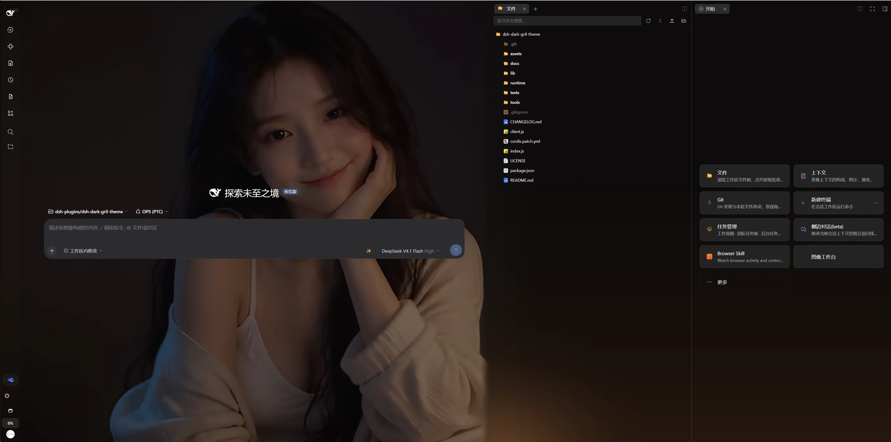
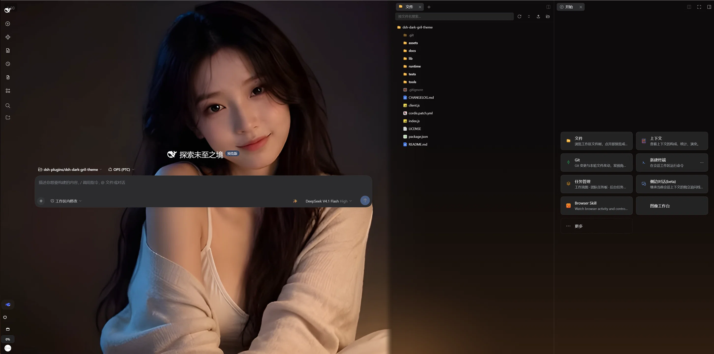

# dsh-dark-gril-theme

把 DeepSeek Harness 的会话状态变成背景视频：左侧栏与中间对话区播视频，右侧工作台保留自建磨砂玻璃，
按 Agent 正在做什么切换片段。

| dark | beautify |
| --- | --- |
|  |  |

两种模式同一份素材、同一套布局，只差三档观感变量；`Ctrl+Alt+M` 原地切换。

## 它做什么

- **按状态换片**：状态变化只在素材边界生效，片段完整播完才切，不打断正在播的画面。
- **换片四种过渡**：`dip` 压暗盖住再揭（默认）/ `wipe` 柔边擦除 / `blur` 失焦 / `cross` 直接叠淡，任一种都保证「同一像素任何时刻只显示一帧」，不会出现两张脸叠在一起；`wipe` 动的是 video 外面裁切容器的 `clip-path`（不碰 video 自己的合成层），过渡靠 CSS 推进，rAF 停了也不会卡在半途；换片前 1.2s 把下一段预载进另一个 `<video>`，被盖住时才换，全程不出空帧。
- **两档观感**：`dark` 走暗玻璃（侧栏压暗 0.48、对话区 0.54、光斑 0.25），`beautify` 全亮。
- **设置页**：DSH 设置 →「Dark Gril 主题」——打光模式、换片过渡方式、压暗/揭开两个时长滑块（0–1200ms）、调试浮窗。
- **调试浮窗**：可拖动、可折叠，显示当前在听什么、在演哪段、下一段预载、桶进度与事件流水。

## 状态与素材

| 态 | 什么时候 | 桶 |
| --- | --- | --- |
| `idle` | 没有回合在跑 | 新会话：`idle` 单段；跑过回合：`idle` `done` `done-soft` `done-confirm` |
| `thinking` | 回合在跑（含子 agent） | `thinking` + 12 段 `speaking-*`，共 13 段 |
| `acting` | 工具连续执行 ≥3s | `acting` `listening` `listening-focus` `listening-nod` |
| `approval` | 等审批，或等你回答问题 | `approval` + 同三段 `listening-*`（与 acting 共用） |
| `done` | 回合刚结束的 12s 窗口 | `done` `done-soft` `done-confirm` |

段数大于 1 的桶不会连抽同一段；单段桶只能重播，这是规则例外。

## 安装

需要 DSH `>=0.2.2-rc.2`（用到 `user-questions/request` 这个 waterfall）与 Node `>=22`。

从 npm 装：

```bash
dsh plugin --profile web add dsh-dark-gril-theme
```

`dsh plugin` 把参数原样转给 profile 目录里的 pnpm，所以等价的直接写法是：

```bash
cd ~/.dsh/profiles/web
pnpm add dsh-dark-gril-theme
```

装完确认 `~/.dsh/profiles/web/package.json` 的 `dsh.profile.bundles` 数组里有 `"dsh-dark-gril-theme"`
（设置 →「插件」页安装会自动加；命令行装完自己看一眼），然后重启 DSH。

包自带 `cordis.patch.yml`（一条 `insert`），loader 按包名自动挂上，不用手写 patch 条目。
升级用 `dsh plugin --profile web add dsh-dark-gril-theme@latest`（`--profile` 必须写在 `add` 之前，写在后面会被 pnpm 当成参数）。

只改 `runtime/` 与 `client.js` 刷新页面即可生效；改 `index.js` 或 `lib/` 必须重启进程。

## 素材

素材（22 段，127MB）不随包发，放在仓库的 `assets` 分支，自己下一步：

```bash
git clone --branch assets --depth 1 https://github.com/TimKingNF/dsh-dark-gril-theme.git /tmp/dgt-assets
mkdir -p ~/.dsh/dsh-dark-gril-theme/assets
cp /tmp/dgt-assets/*.webm ~/.dsh/dsh-dark-gril-theme/assets/
```

插件优先读 `$DSH_HOME/dsh-dark-gril-theme/assets/`（`DSH_HOME` 缺省为 `~/.dsh`），目录里一个视频都没有才回落到包内 `assets/`。
放这里的好处是升级插件不会覆盖你的素材。

文件名即桶里的键名，规格见 [assets/README.md](assets/README.md)。想用自己的素材，按同名替换即可，
分辨率按 2560×1392 设计；缺段会被自动摘掉，整桶摘空就回落到 idle。

## 配置

真相源是 `$DSH_HOME/dsh-dark-gril-theme.json`。设置页的每一项写的就是这个文件，手改也生效（刷新页面）。

| 键 | 默认 | 说明 |
| --- | --- | --- |
| `enabled` | `true` | 关掉后整层不注入，页面回原生外观 |
| `asset` | `idle.webm` | 阶段一的固定素材，现在只作兜底 |
| `sidebarDim` | `0.48` | 左侧栏压暗 |
| `convDim` | `0.54` | 中间对话区压暗 |
| `glow` | `1` | 光斑强度 |
| `focusX` / `focusY` | `78` / `40` | 光斑位置（百分比） |
| `beautify` | `false` | 打光模式开关 |
| `transition` | `dip` | 换片过渡：`dip` 压暗盖住再揭（默认）/ `wipe` 柔边擦除 / `blur` 失焦 / `cross` 直接叠淡 |
| `dipInMs` | `250` | 换片时压暗多久（0–1200） |
| `dipOutMs` | `400` | 压暗之后揭开多久（0–1200）；两者之和会放大边界提前量 |
| `wipeMs` | `600` | 柔边擦除扫过整幅的时长（0–2000） |
| `blurMs` | `600` | 失焦过渡的总时长（0–2000） |
| `debug` | `false` | 调试浮窗开关 |

坏键、坏文件一律退化成默认值并 warn 一次，不会把 DSH 拉不起来。

## 快捷键

| 快捷键 | 作用 |
| --- | --- |
| `Ctrl + Alt + M` | 在 dark / beautify 之间切换（与设置页开关同一份配置） |
| `Ctrl + Alt + T` | 换片过渡轮换：`dip` 压暗（默认）/ `wipe` 柔边擦除 / `blur` 失焦 / `cross` 叠淡 |
| `Ctrl + Alt + B` | 临时关掉整个背景层，不写配置，再按回来 |

## 调试浮窗

打开后常驻左下角，标题条可拖动（位置只记在本次会话），右上角 `−` / `+` 折叠。五张卡：

- **状态源 · 在听什么**：SSE / 轮询、当前监听到的态、快照序号与时间、多久前到达、会话与底层态
- **播放 · 在演什么**：片段名、对应态、播放进度、元素、剩余时间
- **预载 · 下一段**：已预载的片段、它对应的态、在桶里的序号、是否就绪
- **当前轮播桶**：整桶 chip，标出 ▶ 正在播与 ⏭ 预载目标
- **最近变化**：最近 8 条事件流水

## 已知限制

- **后台标签页不解码视频**：浏览器会挂起媒体加载，Agent Window 里的预览常常停在 0 帧。这是浏览器行为，不是插件故障，前台窗口正常。
- **素材不随包**：不下载素材也能装，但只有暗玻璃，没有视频。
- **配置写接口只挡网页跨站**：`POST /dsh-dark-gril-theme/config.json` 只接受 `application/json` 正文，并拒绝 Origin 与 Host 不一致的请求；本机其它进程仍可写——这是本地工具，不做鉴权。
- **只在 web profile 验过**：`dsh.client.platform` 为 `web`，桌面端未测。

## 开发

```bash
npm test           # node --check 全部入口 + 49 例单测
npm run pack:check
```

进度、修订号与踩坑记录在 `docs/status.md`；素材路由与布局的调试起 `node tools/dev-server.mjs`。

## 许可

[GNU General Public License v3.0 or later](LICENSE)（`GPL-3.0-or-later`）。
